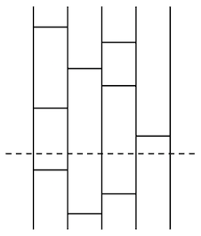
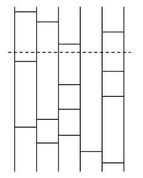

## 문제 설명

아미다쿠지를 매우 좋아하는 유키코쨩은 올해도 “아미다 Advent Calendar”를 위해 아미다쿠지를 만들려고 합니다.

유키코쨩은 먼저 아미다쿠지의 출발점과 도착점의 대응을 정한 뒤 만들기 시작했습니다. 처음에는 순조로웠지만 다른 Advent Calendar에 정신이 팔린 사이 담당일 전날이 되었고, 손에 남은 것은 완성 중인 아미다쿠지뿐입니다. 유키코쨩 대신 아미다쿠지를 완성하는 프로그램을 작성하세요.


완성 중인 아미다쿠지는 세로선 $N$개와 세로선에 수직인 가로 막대 $K$개로 이루어져 있습니다. $K$개의 가로 막대는 모두 높이가 다르며, 위에서 $k$번째 가로 막대는 왼쪽에서 $X_k$번째 세로선과 $Y_k$번째 세로선을 연결합니다.

유키코쨩이 처음 정한 출발점과 도착점의 대응은 $1\sim N$의 순열 $A_i$($1\le i\le N$)로 나타냅니다. 이는 왼쪽에서 $i$번째 세로선에서 출발하면 왼쪽에서 $A_i$번째 세로선에 도착한다는 뜻입니다.

## 입력

```text
$N$
$K$
$X_1\ Y_1$
$\vdots$
$X_K\ Y_K$
$A_1\ \dots\ A_N$
```

## 제한

- 입력으로 주어지는 모든 수는 정수입니다.
- $2 \le N \le 100$
- $0 \le K \le 6\,000$
- $1 \le X_i < Y_i \le N$
- $Y_i=X_i+1$
- $A_i$는 $1,2,\ldots,N$의 순열입니다.

## 출력

위에서 $K$번째 가로 막대보다 아래에 가로 막대를 몇 개 추가하여 아미다쿠지를 완성하세요.

**이 문제는 스페셜 저지입니다. 아래 출력 형식을 만족하는 해가 여러 개라면 어느 것을 출력해도 됩니다. 출력 가능한 해가 적어도 $1$개 존재하는 것이 보장됩니다.**

### 출력 형식

```text
$L$
$X_{K+1}\ Y_{K+1}$
$\vdots$
$X_{K+L}\ Y_{K+L}$
```

출력은 모두 정수이며 다음 조건을 만족해야 합니다.

- 가로 막대 $L$개를 추가합니다.
- 완성된 아미다쿠지는 가로 막대 $K+L$개로 이루어지고, 출발점과 도착점의 대응이 $A$와 일치합니다.
- 모든 가로 막대의 높이는 서로 다르며, 위에서 $k$번째($1\le k\le K+L$) 가로 막대는 왼쪽에서 $X_k$번째와 $Y_k$번째 세로선을 연결합니다.
- $0 \le L \le 6\,000$
- $1 \le X_i < Y_i \le N$
- $Y_i=X_i+1$

## 예제

### 예제 1 {file=""}

#### 입력

```text
5
6
1 2
3 4
2 3
3 4
1 2
4 5
5 1 4 3 2
```

#### 출력

```text
3
1 2
3 4
2 3
```

예를 들어 아래 그림처럼 가로 막대 $3$개를 추가하면 완성됩니다.



### 예제 2 {file=""}

#### 입력

```text
6
4
1 2
2 3
5 6
3 4
2 6 3 1 5 4
```

#### 출력

```text
11
1 2
5 6
3 4
5 6
3 4
2 3
1 2
3 4
2 3
4 5
5 6
```

예를 들어 아래 그림처럼 가로 막대 $11$개를 추가하면 완성됩니다.



