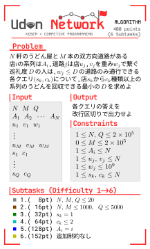
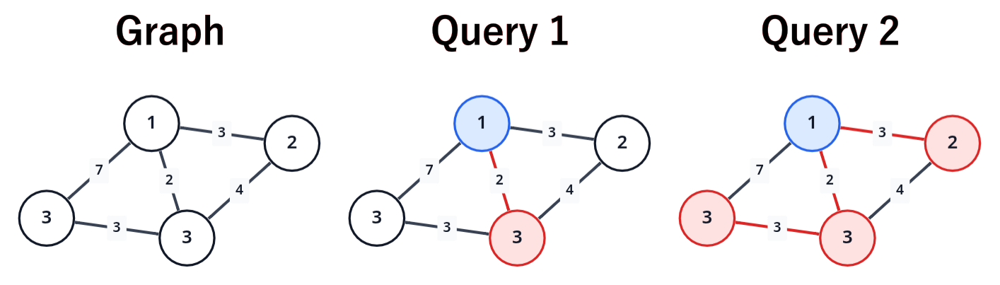
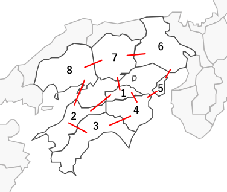

**高専競プロ鯖**

## 이 문제에 대해

이 문제는 高専プロコン 행사에서 배포할 홍보지를 위해 **高専競プロ鯖**가 만들었습니다. 고등전문학교 학생이든 아니든 부담 없이 풀어 보세요!

대략적인 해설은 yukicoder의 해설에 적어 두었습니다. 여유가 있으면 대회 프로그래밍을 해 본 적 없는 사람을 위한 해설 글도 만들 수 있습니다.

<details>
<summary>행사용 문제 이미지 (클릭해서 펼치기)</summary>



이미지의 일본어 설명은 다음과 같습니다.

- 문제: 우동 가게 $N$개와 양방향 도로 $M$개가 있습니다. 가게 $i$의 계열은 $A_i$입니다. 도로는 순례도가 $w$ 이상이면 통행할 수 있습니다. 도로 $(u_i,v_i)$를 통행하려면 순례도가 $w_i$ 이상이어야 합니다. 각 질의 $(s_k,c_k)$에 대해, 가게 $s_k$에서 출발하여 $c_k$종류 이상의 계열의 우동을 회수하는 데 필요한 순례도의 최솟값을 구하세요.
- 출력: 각 질의의 답을 줄바꿈으로 구분하여 출력하세요.
- 부분문제 $6$의 「追加制約なし」는 「추가 제한 없음」을 뜻합니다.

이미지의 입력 형식과 수치 제한 및 부분점은 아래에 제시되어 있습니다.

</details>

## 문제 난이도에 대해

초보자부터 상급자까지 즐길 수 있도록 부분점이 설정되어 있습니다.

각 부분문제의 예상 난이도를 AtCoder의 Difficulty로 환산하면 다음과 같습니다.

- **부분문제 $1$: 회색**
- **부분문제 $2$: 갈색**
- **부분문제 $3$: 초록색**
- **부분문제 $4$: 하늘색**
- **부분문제 $5$: 파란색**
- **부분문제 $6$ (만점): 노란색**

모든 부분문제에서 `C++23`과 `Python(PyPy3)`의 **의도된 풀이가 정답을 받는 것**을 확인했습니다. 다만 `Python(PyPy3)`는 시간제한이 빠듯한 부분문제가 있어, 같은 시간 복잡도라도 구현에 따라 `TLE`를 받을 수 있습니다. 이 경우 생성형 AI 등을 이용해 프로그램을 `C++`로 변환하는 것을 권장합니다.

---

## 문제 설명

高専太郎くん이 사는 K현에는 우동 가게 $N$개와 도로 $M$개가 있습니다. 가게 $i\ (1 \le i \le N)$는 계열 $A_i$에 속하며, 도로 $j\ (1 \le j \le M)$는 가게 $u_j$와 $v_j$를 양방향으로 잇습니다.

K현에서는 각 도로에 **순례도**라는 정숫값이 설정되어 있습니다. 도로 $j$의 순례도는 $w_j$이며, 이 도로는 순례도가 $w_j$ 이상인 사람만 통행할 수 있습니다.

질의 $Q$개가 주어집니다. $k\ (1 \le k \le Q)$번째 질의는 다음과 같습니다.

> 정수 $s_k,c_k$가 주어집니다.
>
> 타로군은 가게 $s_k$에서 출발하여 도달할 수 있는 모든 우동 가게를 방문하고, 각 가게가 속한 계열의 우동을 회수합니다.
>
> 타로군이 $c_k$**종류** 이상 계열의 우동을 회수하는 데 필요한 순례도의 최솟값을 구하세요. 순례도가 아무리 높아도 $c_k$종류 이상 계열의 우동을 회수할 수 없으면 $-1$을 출력하세요.

## 입력

```text
$N\ M\ Q$
$A_1\ A_2\ \cdots\ A_N$
$u_1\ v_1\ w_1$
$u_2\ v_2\ w_2$
$\vdots$
$u_M\ v_M\ w_M$
$\text{query}_1$
$\text{query}_2$
$\vdots$
$\text{query}_Q$
```

$k$번째 질의 $\text{query}_k$는 다음 형식으로 주어집니다.

```text
$s_k\ c_k$
```

## 제한

- 입력으로 주어지는 모든 수는 정수입니다.
- $1 \le N \le 2\times 10^5$
- $0 \le M \le 2\times 10^5$
- $1 \le Q \le 2\times 10^5$
- $1 \le A_i \le N$
- $1 \le u_j,v_j \le N$
- $1 \le w_j \le 10^9$
- $1 \le s_k,c_k \le N$
- 어느 두 가게 사이든 도로를 따라 서로 오갈 수 있습니다.
- 같은 두 가게를 직접 잇는 도로가 두 개 이상 존재하지 않습니다.

### 부분점

이 문제에는 부분문제별 부분점이 설정되어 있습니다.

| 부분문제 | 배점 | 제한 |
| --- | --- | --- |
| 부분문제 $1$ | $2$% ($8$점) | $N,M,Q \le 20$ |
| 부분문제 $2$ | $4$% ($16$점) | $N,M \le 1\,000,\ Q \le 5\,000$ |
| 부분문제 $3$ | $8$% ($32$점) | $s_k=1$ |
| 부분문제 $4$ | $16$% ($64$점) | $c_k \le 2$ |
| 부분문제 $5$ | $32$% ($128$점) | $A_i=i$ |
| 부분문제 $6$ | $38$% ($152$점) | 추가 제한 없음 |

**각 부분문제는 앞선 부분문제의 제한을 반드시 물려받는 것은 아닙니다.** 예를 들어 부분문제 $3$의 제한을 만족하는 테스트 케이스가 부분문제 $2$의 제한을 만족하지 않을 수 있습니다.

테스트 케이스는 부분문제 번호가 작은 순서대로 실행됩니다. yukicoder에서는 `TLE`를 받으면 그 시점에서 채점이 중단됩니다. 따라서 필요에 따라 `assert` 함수 등을 이용해 풀지 않을 부분문제에서는 프로그램을 종료하는 것을 권장합니다.

모든 부분문제에서 정답을 받아야 `AC`가 됩니다.

## 출력

각 질의의 답을 한 줄씩 출력하세요. 마지막 출력 끝에도 줄바꿈을 넣으세요.

## 예제

### 예제 1 {file="00_03_sample_01.txt"}

#### 입력

```text
4 5 2
1 2 3 3
1 2 3
2 3 4
3 4 3
4 1 7
1 3 2
1 2
1 3
```

#### 출력

```text
2
3
```

이 입력은 부분문제 $1,2,3,6$의 제한을 만족합니다.

입력을 그림으로 나타내면 다음과 같습니다. 각 정점에 적힌 수는 해당 가게가 속한 계열입니다. 파란 정점은 출발점, 빨간 정점은 출발점에서 도달할 수 있는 정점입니다.

<details>
<summary>예제 입력 그림 (클릭해서 펼치기)</summary>



</details>

- 질의 $1$

파란 정점 $(s_1=1)$에서 출발합니다. 순례도가 $D=2$이면 파란 정점과 빨간 정점이 속한 계열은 $c_1=2$종류 이상입니다. $D<2$이면 $2$종류 이상 계열의 우동을 회수할 수 없으므로, 조건을 만족하는 최소 순례도 $2$를 출력합니다.

- 질의 $2$

파란 정점 $(s_2=1)$에서 출발합니다. 순례도가 $D=3$이면 파란 정점과 빨간 정점이 속한 계열은 $c_2=3$종류 이상입니다.

이때 도달할 수 있는 정점은 총 $4$개이지만, 구하는 것은 정점 수가 아니라 정점들이 속한 계열의 **종류 수**라는 점에 주의하세요.

$D<3$이면 $3$종류 이상 계열의 우동을 회수할 수 없으므로, 조건을 만족하는 최소 순례도 $3$을 출력합니다.

### 예제 2 {file="00_05_sample_02.txt"}

#### 입력

```text
8 10 6
1 2 3 4 5 6 7 8
1 2 132333
1 7 13100
4 3 108976
5 6 3911
1 4 55714
4 5 1629
2 8 59400
8 7 135765
2 3 79481
6 7 115502
1 2
7 2
5 2
5 3
5 6
5 8
```

#### 출력

```text
13100
13100
1629
3911
108976
108976
```

이 입력은 부분문제 $1,2,5,6$의 제한을 만족합니다.

<details>
<summary>예제 입력 그림 (클릭해서 펼치기)</summary>

올해 高専プロコン은 가가와현에서 열립니다.



<details>
<summary>이미지에 대해</summary>

[원본 이미지 (Wikipedia)](https://ja.wikipedia.org/wiki/%E3%83%95%E3%82%A1%E3%82%A4%E3%83%AB:Map_of_Japan_010.svg): Monaneko / [CC BY-SA 3.0](https://creativecommons.org/licenses/by-sa/3.0/)

원본 이미지를 가공해서 사용했습니다.

</details>

</details>

### 예제 3 {file="00_03_04_05_sample_03.txt"}

#### 입력

```text
1 0 1
1
1 1
```

#### 출력

```text
0
```

이 입력은 모든 부분문제의 제한을 만족합니다.

출발점인 가게의 우동도 회수할 수 있다는 점에 주의하세요.

### 예제 4 {file="00_sample_04.txt"}

#### 입력

```text
16 19 5
6 11 9 12 12 8 3 12 3 14 2 12 16 8 9 4
3 15 496513734
3 10 221107446
3 16 526825332
3 11 800915964
10 14 569184838
4 15 653916233
13 16 234134147
12 14 205768486
2 10 921532315
8 15 825947957
4 9 632723847
1 15 365777683
6 9 572312537
3 5 731148890
7 10 37197809
1 11 251721087
10 12 77987919
9 10 142437714
6 14 57202237
1 13
6 10
9 3
9 11
3 16
```

#### 출력

```text
-1
921532315
142437714
-1
-1
```

이 입력은 부분문제 $1,2,6$의 제한을 만족합니다.

### 예제 5 {file="00_sample_05.txt"}

#### 입력

```text
15 14 15
10 4 14 13 7 7 4 6 13 2 5 4 15 14 11
4 14 18416279
4 6 508296217
4 15 170711604
1 15 382401200
6 8 819754912
6 11 481535667
2 14 612834952
8 13 588801115
2 5 427235646
1 9 262676442
7 8 694213369
5 12 513030814
3 6 772381404
10 12 449299186
6 15
10 1
10 3
4 8
1 12
13 8
10 5
5 13
4 3
6 5
2 1
5 8
4 11
8 13
10 7
```

#### 출력

```text
-1
0
513030814
612834952
-1
819754912
612834952
-1
170711604
508296217
0
612834952
-1
-1
612834952
```

이 입력은 부분문제 $1,2,6$의 제한을 만족합니다.
