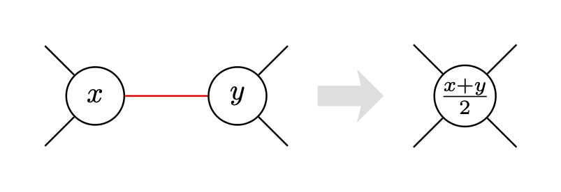
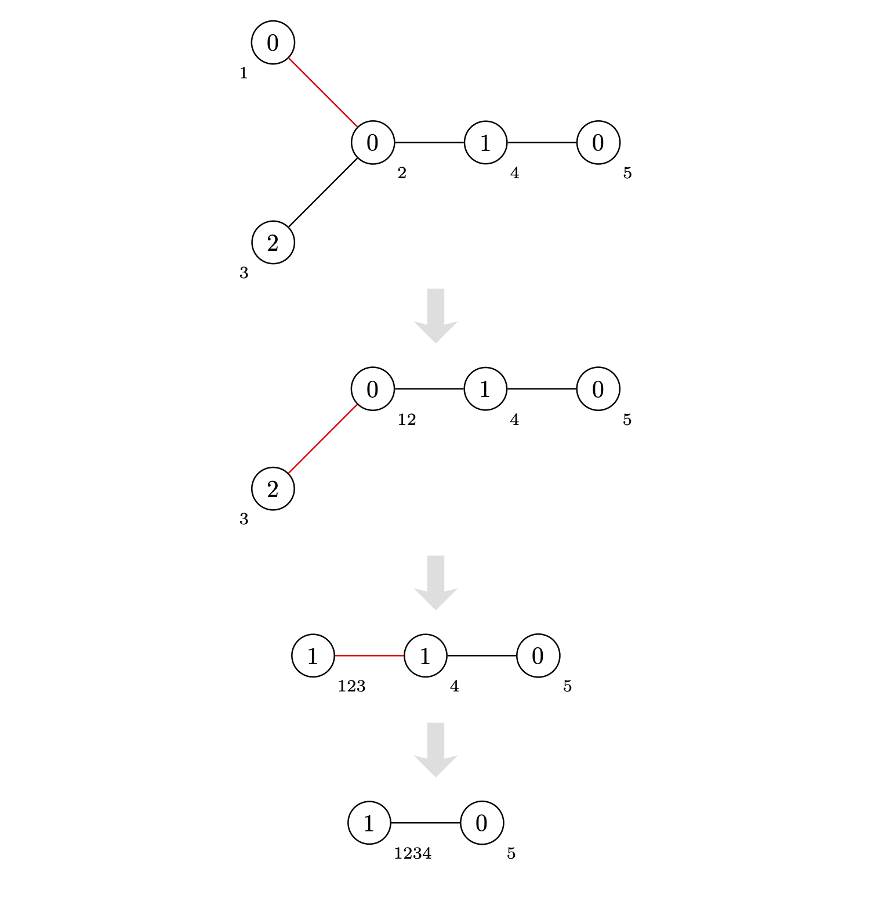

## 문제 설명

정점 $N$개의 트리가 주어집니다. 정점에는 $1$부터 $N$까지 번호가 붙어 있고, $i$번째 간선은 정점 $u_i$와 $v_i$를 잇습니다.

정점 $i$에는 정수 $A_i$가 적혀 있습니다. $A_i$는 $0,1,2$ 중 하나입니다.

이 트리에 다음 연산을 합니다.

- 간선을 하나 고릅니다. 단, 양 끝점에 적힌 정수 $x,y$의 홀짝이 같은 간선만 고를 수 있습니다. 고른 간선을 축약하고, 새로 생긴 정점에 $\dfrac{x+y}{2}$를 적습니다.



연산을 할 수 있는 횟수의 최댓값을 구하세요.

<details>
<summary>축약에 대한 보충 설명</summary>

정점 $u$와 $v$를 잇는 간선을 고르면, 정확히는 다음 과정을 수행합니다.

1. 정점 $u,v$에 적힌 정수를 각각 $x,y$라고 하고, 정수 $\dfrac{x+y}{2}$가 적힌 정점 $w$를 새로 추가합니다.
2. 정점 $u$ 또는 $v$를 끝점으로 하는 간선 중 $u$와 $v$를 잇는 간선을 제외한 모든 간선에 대해, $u,v$가 아닌 쪽 끝점을 $t$라고 하고 정점 $t$와 $w$를 잇는 간선을 추가합니다.
3. 정점 $u,v$와, $u,v$ 중 적어도 하나를 끝점으로 하는 모든 간선을 삭제합니다.

</details>

## 입력

```text
$N$
$u_1\ v_1$
$u_2\ v_2$
$\vdots$
$u_{N-1}\ v_{N-1}$
$A_1\ A_2\ \dots\ A_N$
```

## 제한

- 입력으로 주어지는 모든 수는 정수입니다.
- $2 \leq N \leq 10^5$
- $1 \leq u_i,v_i \leq N$
- $\color{red}A_i \in \lbrace 0,1,2\rbrace$
- 주어지는 그래프는 트리입니다.

## 출력

연산을 할 수 있는 횟수의 최댓값을 출력하세요.

## 예제

### 예제 1 {file=""}

#### 입력

```text
5
1 2
2 3
2 4
4 5
0 0 2 1 0
```

#### 출력

```text
3
```

최대 연산 횟수는 $3$입니다. 아래 그림은 연산을 $3$번 하는 방법의 예입니다. 빨간 간선은 각 단계에서 고르는 간선입니다.



$3$번의 연산 후 유일한 간선은 $0$이 적힌 정점과 $1$이 적힌 정점을 잇습니다. 홀짝이 다르므로 더는 연산할 수 없습니다.

### 예제 2 {file=""}

#### 입력

```text
2
1 2
0 1
```

#### 출력

```text
0
```

연산을 한 번도 할 수 없습니다.

### 예제 3 {file=""}

#### 입력

```text
10
1 2
2 3
2 4
1 5
5 6
5 7
5 8
4 9
7 10
0 1 1 0 2 0 2 0 0 0
```

#### 출력

```text
6
```
