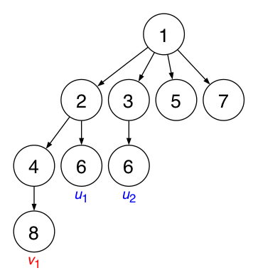

이 문제의 시간 제한은 $6$초입니다.

## 문제 설명

$X=10^{10^{100}}$이라고 합시다. 다음 조건을 모두 만족하는 루트가 있는 트리가 유일하게 존재함을 증명할 수 있습니다. 이 트리를 $T$라고 합니다.

- 각 정점에는 $1$ 이상 $X$ 이하의 정수가 하나씩 적혀 있고, 루트에 적힌 값은 $1$입니다. 여러 정점에 같은 값이 적혀 있어도 됩니다.
- 임의의 정점 $u$에 대해, $u$를 루트로 하는 서브트리에서 $u$ 자신을 포함하여 적어도 한 정점에 적힌 정수들의 집합을 $S$라고 하고, $u$에 적힌 정수를 $x$라고 하면 $S=\{mx|1\le m\le \lfloor\frac{X}{x}\rfloor\}$입니다. 즉, $x$가 적힌 정점을 루트로 하는 서브트리에는 $1$ 이상 $X$ 이하인 $x$의 모든 배수가 적어도 한 번 나타나고, 다른 값은 나타나지 않습니다.
- 위 두 조건을 모두 만족하는 트리 중 정점 수가 최소입니다.

정점 쌍 $(u,v)$에 대해, $T$에서 $u,v$를 잇는 유일한 단순 경로 위의 모든 정점에 적힌 정수의 최솟값을 $\operatorname{score}(u,v)$라고 합니다. 이때 양 끝점 $u,v$도 포함합니다.

정수 $A,B$가 소인수분해된 형태로 주어집니다. 즉, $A=\prod\limits_{i=1}^N p_i^{\alpha_i}$, $B=\prod\limits_{j=1}^M q_j^{\beta_j}$이며 $p_i,q_j$는 소수입니다.

$T$에서 정수 $A$가 적힌 모든 정점의 집합을 $U$, 정수 $B$가 적힌 모든 정점의 집합을 $V$라고 할 때, $\sum\limits_{u\in U}\sum\limits_{v\in V}\operatorname{score}(u,v)$를 $998\,244\,353$으로 나눈 나머지를 구하세요.

## 입력

```text
$N\ M$
$p_1\ \alpha_1$
$\vdots$
$p_N\ \alpha_N$
$q_1\ \beta_1$
$\vdots$
$q_M\ \beta_M$
```

## 제한

- $1\le N,M\le 10^5$
- $1\le p_i,q_j\le 10^9$ $(1\le i\le N,\ 1\le j\le M)$
- $p_i,q_j$는 소수입니다. $(1\le i\le N,\ 1\le j\le M)$
- $p_{i_1}\ne p_{i_2}$ $(1\le i_1<i_2\le N)$
- $q_{j_1}\ne q_{j_2}$ $(1\le j_1<j_2\le M)$
- $1\le\alpha_i,\beta_j$ $(1\le i\le N,\ 1\le j\le M)$
- $\sum\limits_{i=1}^N\alpha_i,\ \sum\limits_{j=1}^M\beta_j\le 10^5$
- 입력으로 주어지는 모든 수는 정수입니다.

## 출력

답을 한 줄에 출력하세요. 마지막에 줄바꿈을 출력하세요.

## 예제

### 예제 1 {file=""}

#### 입력

```text
2 1
2 1
3 1
2 3
```

#### 출력

```text
3
```



$A=2^1\cdot 3^1=6$, $B=2^3=8$입니다. $T$에서 $8$ 이하의 값이 적힌 정점을 포함하는 부분을 뽑아내면 그림과 같습니다.

그림과 같이 $6$이 적힌 정점을 $u_1,u_2$, $8$이 적힌 정점을 $v_1$이라고 하면 $\operatorname{score}(u_1,v_1)=2$, $\operatorname{score}(u_2,v_1)=1$이므로 답은 $3$입니다.

### 예제 2 {file=""}

#### 입력

```text
2 2
2 3
3 1
3 2
2 2
```

#### 출력

```text
77
```

### 예제 3 {file=""}

#### 입력

```text
3 4
611951 20000
350377 30000
882377 40000
104729 10000
287117 60000
415087 10000
746773 10000
```

#### 출력

```text
923860980
```
