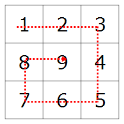

## 문제 설명

$N$행 $N$열의 격자에 $1$부터 $N \times N$까지의 숫자를 중심을 향해 소용돌이를 그리듯 순서대로 채운 결과를 출력하세요.

소용돌이는 왼쪽 위에서 시작하여 처음에는 오른쪽으로 직진합니다. 앞이 격자 범위 밖이거나 이미 지나간 칸이면 직각으로 꺾을 수 있는 방향으로 꺾습니다.

아래는 $N = 3$인 경우의 예입니다.



## 입력

```text
$N$
```

## 제한

- $N$은 정수입니다.
- $1 \leq N \leq 30$

## 출력

$N$행 $N$열의 숫자 소용돌이를 출력하세요. 두 자리 이하의 숫자는 앞에 `0`을 필요한 만큼 붙여 세 자리로 만드세요. 숫자 사이에는 반각 공백을 넣으세요.

## 예제

### 예제 1 {file=""}

#### 입력

```text
3
```

#### 출력

```text
001 002 003
008 009 004
007 006 005
```

### 예제 2 {file=""}

#### 입력

```text
4
```

#### 출력

```text
001 002 003 004
012 013 014 005
011 016 015 006
010 009 008 007
```
