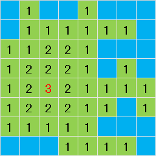
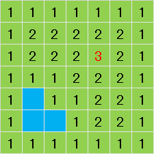

## 참고

작성자의 풀이로 C++, C#, Java, PyPy는 모든 테스트 케이스를 통과할 수 있음을 확인했지만, 그 밖의 느린 언어로 통과하기는 어려울 수 있습니다.

## 문제 설명

세로 $H$, 가로 $W$ 크기의 지도가 있습니다. 지도에는 각 장소가 육지인지 바다인지에 대한 정보가 주어집니다. 지도 밖의 영역은 모두 바다입니다.

바다로부터 체비쇼프 거리가 가장 먼 장소의 그 거리를 구하세요.

(추가)

[체비쇼프 거리](https://ja.wikipedia.org/wiki/チェビシェフ距離)는 두 점의 좌표가 $(x_1,y_1),(x_2,y_2)$일 때 $\max(\lvert x_1-x_2\rvert,\lvert y_1-y_2\rvert)$로 정의됩니다.

어떤 육지와 바다 사이의 거리는 해당 육지와 모든 바다 칸 사이의 체비쇼프 거리 중 최솟값입니다.

## 입력

`#`은 육지, `.`은 바다를 나타냅니다.

```text
$H\ W$
$S_1$
$S_2$
$\vdots$
$S_H$
```

## 제한

- $H$와 $W$는 정수입니다.
- $1\le H,W\le3\,000$
- $S_i$는 `#`과 `.`으로 이루어진 길이 $W$의 문자열입니다.
- 육지는 하나 이상 존재합니다.

## 출력

바다로부터 체비쇼프 거리가 가장 먼 장소의 그 거리를 출력하세요.

## 예제

### 예제 1 {file=""}

#### 입력

```text
8 8
.#..#...
.######.
#####...
#####.#.
########
######.#
#####...
...####.
```

#### 출력

```text
3
```

초록색 부분을 육지, 하늘색 부분을 바다로 했을 때 각 육지의 바다로부터의 체비쇼프 거리는 그림과 같습니다. 체비쇼프 거리가 가장 큰 곳의 값이 $3$이므로 이를 출력합니다.



### 예제 2 {file=""}

#### 입력

```text
7 7
#######
#######
#######
#######
#.#####
#..####
#######
```

#### 출력

```text
3
```

섬 안에 바다가 존재할 수 있습니다. 또한 지도 범위 밖은 모두 바다라는 점에 주의하세요.



### 예제 3 {file=""}

#### 입력

```text
60 60
............................................................
............................................................
........................................#...............##..
.......................................####............##...
.........................................##...........##....
.........................................###........#.......
.........................................#####...#..#.......
.........................................#########....#.....
........................................###########.........
........................................#############.......
.....................................##.##########..........
......................................#########.............
.....................................#########..............
....................................##.#...###..............
...................................###.......#..............
.....................................###....................
.....................................#......................
.......................................##...................
......................................#.#...................
.....................................####...................
.....................................####...................
.....................................#####..................
.....................................######.................
.....................................######.................
.....................................######.................
.....................................#####..................
....................................#####...................
....................................#####...................
....................................######..................
...................................#####....................
................................#.######....................
.................................#######....................
............................#...########....................
............................#.##########....................
...........................############.....................
...........................############.....................
..........................#############.....................
.........................###############....................
....................###..##############.....................
...............#####################.##.....................
..............###################.#..#......................
.....#......###############.####..#.........................
..........########......###.................................
..........####....##.#.#####................................
......#.##...#.######..###..................................
.....##.####...######..##...................................
......######..####.#........................................
...#...######.###...........................................
......##.####..#............................................
.......#.###................................................
........####................................................
.......####.................................................
.......####.................................................
.......#.##.................................................
............................................................
..........#.................................................
........#.#.................................................
............................................................
............................................................
............................................................
```

#### 출력

```text
4
```
